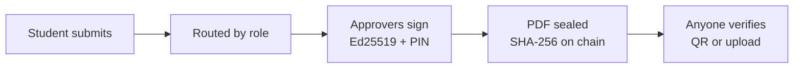

<p align="center">
  
</p>

<h1 align="center">CampusSign</h1>

<p align="center">
  <b>Role-routed digital approvals for universities, sealed on a blockchain.</b><br>
  <i>No queues. No paper. No forged signatures.</i>
</p>

<p align="center">
  <a href="https://github.com/Siddhesh-source/mit_wpu/actions/workflows/ci.yml"></a>
  <a href="https://github.com/Siddhesh-source/mit_wpu/releases"></a>
  
  
  
</p>

<p align="center">
  <a href="https://campussign.duckdns.org"><b>Try it live</b></a> ·
  <a href="https://campussign.duckdns.org/verify">Verify a document</a> ·
  <a href="https://github.com/Siddhesh-source/mit_wpu/issues/new/choose">Report a bug</a>
</p>

---

A student submits a form once. CampusSign sends it to the right approvers by role, each approver signs with a 4-digit PIN, and the final PDF's SHA-256 hash is written to a blockchain. Anyone can check a copy by scanning its QR code or uploading the file. If one byte has changed, it shows **Tampered**.



## Features

| Feature | What it does |
| --- | --- |
| **Role routing** | Each request type is an ordered chain of roles (Coordinator → HoD ‖ Security → Dean), resolved to real people by department. |
| **Sign in place** | Upload any PDF, choose signers in order and place signature boxes. Each signer's saved signature is stamped into their box. |
| **Amendments** | Edit a sealed approval and only the approvers affected by the change sign again. v2 is linked on chain; v1 verifies as *Superseded*. |
| **Revocation** | The HoD or Dean revokes an approval; every copy then verifies as *Revoked*. |
| **Offline gate check** | Security guards check a signed QR pass on their phone with no internet. Passes are valid only on the event date. |
| **Workflow tools** | Attachments, no-dues clearance, deadlines with escalation, delegation, batch approve, audit log, email notifications. |

> [!NOTE]
> Only hashes and status go on chain. Names, form contents and files stay off chain.

## Getting started

Requires **Node 20+**.

```bash
git clone https://github.com/Siddhesh-source/mit_wpu.git campussign
cd campussign
cp .env.example .env
npm install
npm run dev        # local chain :8545 · API :4000 · web :5173
```

Open http://localhost:5173 and create an account.

| Command | Purpose |
| --- | --- |
| `npm test` | Runs the API and contract tests against a real local chain |
| `npm run build && npm run start:local` | Production build served on one port (:4000) |

<details>
<summary><b>Configuration</b></summary>

All settings live in [`.env.example`](.env.example). The main ones:

| Variable | Purpose |
| --- | --- |
| `CHAIN_MODE` | `local` (Hardhat), `amoy` (Polygon Amoy testnet) or `off` |
| `JWT_SECRET` | Required in production |
| `PUBLIC_BASE_URL` | Base URL printed into QR codes |
| `EMAIL_PROVIDER` | `log`, `ses` (AWS SES) or `off` |
| `COLLEGE_ID` | Issuing college ID written on chain with every seal |

</details>

## Tech stack

| Layer | Tools |
| --- | --- |
| API | Express, TypeScript, SQLite, pdf-lib, `@noble/ed25519`, ethers v6 |
| Web | React, Vite, Tailwind, installable PWA |
| Chain | Solidity `DocumentRegistry` on Hardhat or Polygon Amoy |
| Tests | Vitest, Supertest, Hardhat |

## Project layout

```
apps/api          API, routing engine, sealing, PDF generation, chain client
apps/web          Web app, verify page, offline gate app
packages/shared   Types, QR pass format, signatures, verification logic
contracts         DocumentRegistry contract
deploy            Server setup scripts, systemd units, Caddy config
```

## Documentation

- [Architecture](docs/ARCHITECTURE.md): services, database and API
- [Trust layer](docs/TRUST.md): what is signed, hashed and anchored
- [Offline gate check](docs/OFFLINE_GATE.md): how passes verify without internet
- [Sign in place](docs/SIGN_IN_PLACE.md): signature boxes on any PDF
- [Deploy on AWS](docs/DEPLOY_AWS.md) · [Email with AWS SES](docs/EMAIL_SES.md)

## Contributing

Bug reports and pull requests are welcome. See [CONTRIBUTING.md](CONTRIBUTING.md). Report security issues privately as described in [SECURITY.md](SECURITY.md).
