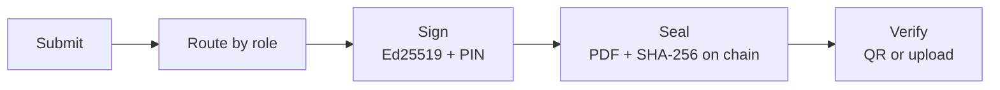

<p align="center">
  
</p>

<h1 align="center">CampusSign</h1>

<p align="center">
  <b>Role-routed digital approvals for universities, sealed on a blockchain.</b><br>
  <i>No queues. No paper. No forged signatures.</i>
</p>

<p align="center">
  <a href="https://campussign.duckdns.org"><b>Live demo</b></a> ·
  <a href="docs/DEMO.md">Demo script</a> ·
  <a href="docs/ARCHITECTURE.md">Architecture</a> ·
  <a href="docs/TRUST.md">Trust model</a>
</p>

<p align="center">
  
  
  
  
  
</p>

---

A student submits a form once. CampusSign routes it to the right people by role, each approver signs with one tap and a PIN, and the final PDF's SHA-256 fingerprint is anchored on chain. Anyone can verify a copy by scanning its QR or uploading the file; change one byte and it reads **Tampered**.



## Features

| | |
| --- | --- |
| **Role routing** | Each request type is a chain of roles, resolved to real people by department. Parallel steps supported (e.g. HoD ‖ Security). |
| **Sign in place** | Upload any PDF, pick signers in order, place signature boxes; saved signatures are stamped in and the copy verifies on chain. |
| **Selective amendment** | Change a sealed approval and only affected approvers sign again; v2 is linked on chain and v1 verifies as *Superseded*. |
| **Revocation** | HoD or Dean revokes; every copy then verifies as *Revoked*. |
| **Offline gate check** | Guards verify a signed QR pass on their phone with no internet, backed by a signed revocation list. |
| **Operations** | Attachments, no-dues clearance, SLA reminders and escalation, delegation, batch approve, audit log, impact dashboard, email (AWS SES). |
| **Open workspace** | Self sign-up for students and staff, teacher connections, classes, and send a document to anyone to sign. |

Only hashes and metadata go on chain. Personal data never does.

## Quick start

Requires Node 20+.

```bash
cp .env.example .env
npm install
npm run dev        # local chain :8545 · API :4000 · web :5173
```

Open http://localhost:5173 and sign up, or log in as `riya@campus.example` / `demo1234` (signing PIN `1234`).

| Command | Purpose |
| --- | --- |
| `npm test` | API (114) and contract (8) tests against a real local chain |
| `npm run build && npm run start:local` | Production build on one port (:4000) |
| `npm run seed:demo` | Reset to the demo starting point |

Set `CHAIN_MODE=amoy` to anchor on Polygon Amoy instead of the local chain. All settings are documented in [`.env.example`](.env.example).

## Stack

- **API:** Express · TypeScript · SQLite · pdf-lib · `@noble/ed25519` · ethers v6
- **Web:** React · Vite · Tailwind · installable PWA
- **Chain:** Solidity `DocumentRegistry` on Hardhat (local) or Polygon Amoy
- **Tests:** Vitest · Supertest · Hardhat

## Project layout

```
apps/api          API, routing engine, sealing, PDF, chain client
apps/web          React app, verify page, offline gate app
packages/shared   Types, QR pass format, signatures, verdict logic
contracts         DocumentRegistry contract and local chain helpers
deploy            EC2 bootstrap, systemd units, Caddy config
docs              Design, architecture and operations docs
```

## Documentation

[Context](docs/CONTEXT.md) · [Architecture](docs/ARCHITECTURE.md) · [Trust layer](docs/TRUST.md) · [Offline gate](docs/OFFLINE_GATE.md) · [Sign in place](docs/SIGN_IN_PLACE.md) · [Design](docs/DESIGN.md) · [Deploy on AWS](docs/DEPLOY_AWS.md) · [Email via SES](docs/EMAIL_SES.md) · [Decisions](docs/DECISIONS.md)
